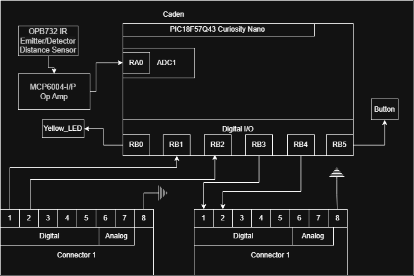

## Overview
This Block Diagram shows the lighting sensor of Team SBWB's electrical system. It uses a lighting sensor and some math to determine the currently angle of the table, and then communicates with a teammate's board to rotate clockwise, rotate counter clockwise, or not rotate at all.

The Block Diagram shows the critical wiring of components to the microcontroller and microcontroller peripherals, to document the necessary details of the system for communication and replication purposes.

## Example Block Diagram 

Figure 1: Team SBWB Light Sensor Block Diagram

draw.io source files: [draw.io Diagram](https://drive.google.com/file/d/1fUdUtB0KPpYzlpJ1xA4XZLehmYxcfwNg/view?usp=sharing)