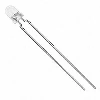
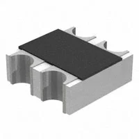
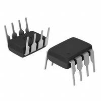
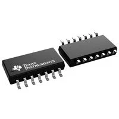
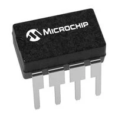
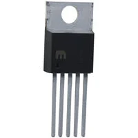

> Also acceptable, more markdown friendly

**Optical Sensing & Distance Detection**

1. Vishay TEFT4300 Photodiode & TSAL6200 IR Emitter Pair

    

    * $0.85 / pair
    * [Vishay TEFT4300 / TSAL6200 Product Link](https://www.digikey.com/en/products/detail/vishay-semiconductor-opto-division/TEFT4300/1681223)

    | Pros | Cons |
    | --- | --- |
    | High optical sensitivity matched at 950 nm peak wavelength | Separate emitter and receiver require precise mechanical alignment on PCB |
    | Standard 5mm through-hole package for easy breadboard setup | Susceptible to high ambient infrared light without proper shielding |
    | Documented switching times for fast object detection | |

2. Everlight ITF8403 Integrated Reflective Sensor

    

    * $0.92 / unit
    * [Everlight ITF8403 Product Link](https://www.digikey.com/en/products/detail/everlight-electronics-co-ltd/ITF8403/2675432)

    | Pros | Cons |
    | --- | --- |
    | Combines IR emitter and phototransistor in a single 4-pin module | Fixed detection range (typically under 15 mm ideal operating distance) |
    | Fixed alignment eliminates positioning errors | Surface-mount footprint requires careful soldering |
    | Integrated daylight blocking filter reduces ambient light noise | |

3. Sharp GP2Y0A21YK0F Analog Distance Sensor

    

    * $11.25 / unit
    * [Sharp GP2Y0A21YK0F Product Link](https://www.digikey.com/en/products/detail/sharp-microelectronics/GP2Y0A21YK0F/1810822)

    | Pros | Cons |
    | --- | --- |
    | Built-in PSD triangulation circuit provides calibrated analog output (10-80 cm) | Significantly higher cost compared to discrete components ($11.25 vs <$1.00) |
    | Insensitive to object color and reflectivity variations | Higher current consumption (~30 mA active) |
    | Simple 3-wire interface directly to microcontroller ADC | Bypasses custom op-amp comparator circuit design requirement |

**Choice:** Option 1: Vishay TEFT4300 Photodiode & TSAL6200 IR Emitter Pair

**Rationale:** Option 1 is the optimal choice for our custom distance sensing subsystem. It provides a discrete solution that allows complete control over the photodiode biasing and gain stage in our custom signal conditioning circuit. Unlike Option 3, which integrates all processing internally, Option 1 satisfies the assignment requirement to implement a custom electrical solution using discrete analog components while keeping unit costs below $1.00.

---

**Signal Conditioning & Amplification**

1. Texas Instruments LM358P Dual Op-Amp

    

    * $0.45 / unit
    * [TI LM358P Product Link](https://www.digikey.com/en/products/detail/texas-instruments/LM358P/277042)

    | Pros | Cons |
    | --- | --- |
    | Low unit cost and widely available 8-pin DIP package | Slower slew rate (0.3 V/µs) and limited bandwidth (0.7 MHz) |
    | Operates reliably from a single 3V to 32V supply rail | Output cannot swing completely rail-to-rail without load resistors |
    | Common-mode input range includes ground, enabling direct sensing near 0V | |

2. Texas Instruments LM393P Dual Differential Comparator

    

    * $0.42 / unit
    * [TI LM393P Product Link](https://www.digikey.com/en/products/detail/texas-instruments/LM393P/277053)

    | Pros | Cons |
    | --- | --- |
    | Dedicated comparator IC optimized for fast digital output switching | Open-collector output requires an external pull-up resistor |
    | Open-collector output allows level shifting between logic voltage levels | Cannot be configured as a linear amplifier if analog gain is required later |
    | Extremely low quiescent current consumption (~0.4 mA per package) | |

3. Microchip MCP6002-I/P Dual Rail-to-Rail Op-Amp

    

    * $0.55 / unit
    * [Microchip MCP6002-I/P Product Link](https://www.digikey.com/en/products/detail/microchip-technology/MCP6002-I-P/500875)

    | Pros | Cons |
    | --- | --- |
    | Full rail-to-rail input and output swing on 1.8V to 6V supplies | Maximum operating supply voltage is limited to 6.0V |
    | Very low quiescent current (100 µA per channel) | Slightly higher unit cost than standard LM358P |
    | 1 MHz gain bandwidth product suitable for DC/low-frequency sensing | |

**Choice:** Option 1: Texas Instruments LM358P Dual Op-Amp

**Rationale:** The LM358P is selected because it provides two independent operational amplifiers in a breadboard-friendly 8-DIP package at a very low price. In our IR proximity circuit, one stage can serve as an analog buffer/preamplifier for the photodiode signal while the second stage functions as a voltage comparator against a potentiometer threshold, providing both analog and digital outputs to the microcontroller.

---

**Power Regulation**

1. STMicroelectronics L7805CV

    

    * $1.08 / unit
    * [ST L7805CV Product Link](https://www.digikey.com/en/products/detail/stmicroelectronics/L7805CV/585964)

    | Pros | Cons |
    | --- | --- |
    | Delivers up to 1.5A continuous output current | High dropout voltage (~2.0V) requires input voltage at or above 7.0V |
    | Built-in thermal overload and short-circuit protection | Linear power dissipation generates heat at higher current draws |
    | TO-220 package allows easy attachment of a heatsink if needed | |

2. Microchip MIC29151-5.0WT Low-Dropout Regulator

    

    * $4.96 / unit
    * [Microchip MIC29151-5.0WT Product Link](https://www.digikey.com/en/products/detail/microchip-technology/MIC29151-5-0WT/771578)

    | Pros | Cons |
    | --- | --- |
    | Very low dropout voltage (350 mV at 1.5A load) | Significantly higher cost ($4.96/unit) |
    | Built-in enable pin for logic-level shutdown | 5-pin TO-220 package requires extra board layout connections |
    | Reverse battery protection improves system durability | |

3. Texas Instruments LM317T Adjustable Regulator

    

    * $0.82 / unit
    * [TI LM317T Product Link](https://www.digikey.com/en/products/detail/texas-instruments/LM317T-NOPB/6178)

    | Pros | Cons |
    | --- | --- |
    | Adjustable output voltage from 1.25V to 37V | Requires two external feedback resistors to set output voltage to 5.0V |
    | Up to 1.5A output current capability | Higher susceptibility to output voltage drift if resistor tolerances vary |
    | Low unit cost | |

**Choice:** Option 1: STMicroelectronics L7805CV

**Rationale:** The L7805CV is the optimal choice for our fixed 5.0V logic and sensor rail. It requires no external voltage setting resistors (unlike the LM317T), provides standard built-in short-circuit and thermal protection, and handles total system current with substantial margin at a low unit cost.

---

***Power Sources**

1. CUI Inc. SWI12-9-N-P5 9V DC Wall Adapter

    

    * $8.45 / unit
    * [CUI SWI12-9-N-P5 Product Link](https://www.digikey.com/en/products/detail/cui-inc/SWI12-9-N-P5/6124508)

    | Pros | Cons |
    | --- | --- |
    | Delivers regulated 9V DC up to 1.33A (12W total power) | Tethered to AC wall outlet, limiting physical mobility |
    | Ideal 9V output keeps input voltage close to 7V dropout limit of L7805CV, minimizing heat | Requires standard 2.1mm DC barrel jack connector on board |
    | Continuous operation without battery maintenance | |

2. Tensility 16-00142 12V DC Wall Adapter

    

    * $8.52 / unit
    * [Tensility 16-00142 Product Link](https://www.digikey.com/en/products/detail/tensility-international-corp/16-00142/10405232)

    | Pros | Cons |
    | --- | --- |
    | Higher 12V output voltage provides robust headroom for external subsystems | Higher voltage drop across the L7805CV regulator generates more thermal heat |
    | Provides up to 18W (1.5A) of continuous power capacity | Larger physical wall-wart enclosure size |
    | Inexpensive at $8.52 per unit | |

3. MG Electronics LBP-124500 12V Rechargeable Lithium-Ion Battery Pack

    

    * $49.95 / unit
    * [MG Electronics LBP-124500 Product Link](https://www.digikey.com/en/products/detail/mg-electronics/LBP-124500/5013735)

    | Pros | Cons |
    | --- | --- |
    | Fully portable 12V DC power source enables untethered system operation | Significantly higher unit cost ($49.95) compared to wall adapters |
    | Includes built-in multi-chemistry rechargeable cells and output leads | Requires periodic recharging and eventual battery pack replacement |
    | Steady voltage output suitable for regulated linear circuits | Adds substantial weight to the overall assembly |

**Choice:** Option 2: Tensility 16-00142 12V DC Wall Adapter

**Rationale:** The 12V wall adapter is selected as the optimal power source because it provides a reliable, tethered desktop power supply with a higher input voltage headroom (12V) compared to a 9V source. This ensures sufficient input stability above the L7805CV linear regulator's dropout threshold while supporting up to 1.5A of continuous current, meeting all system power demands without requiring battery maintenance.