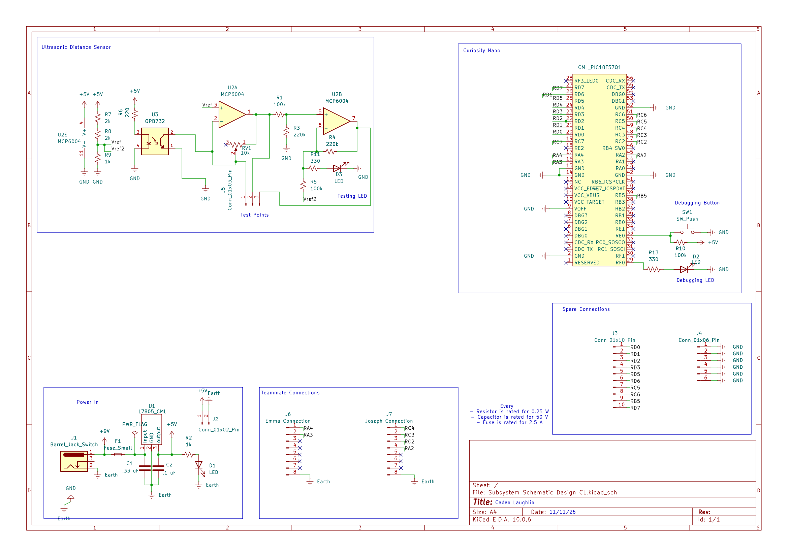

## Overview

This schematic is design to support distance sensing via infrared.

{style width:"350" height:"300;"}

## Resouces

The schematic as a PDF download is available [*here*](Subsystem Schematic Design CL.pdf), and the Zip folder of the project [*here*](Subsystem Schematic Design CL.zip).