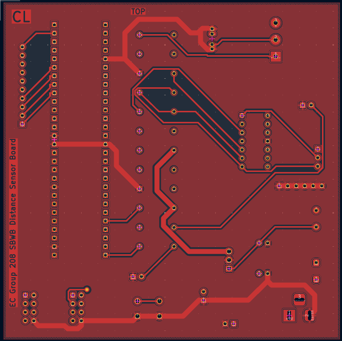
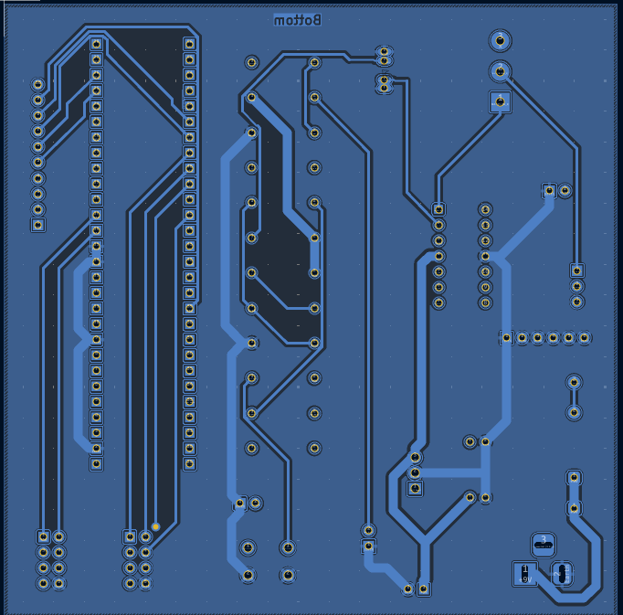
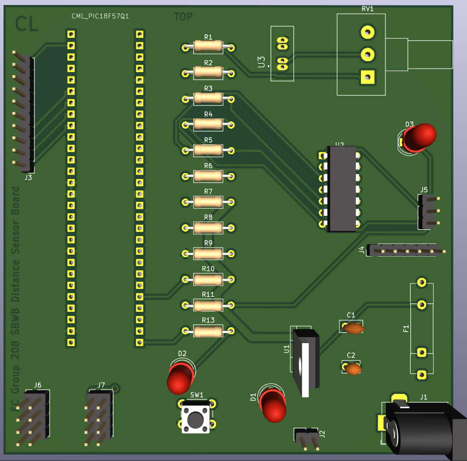
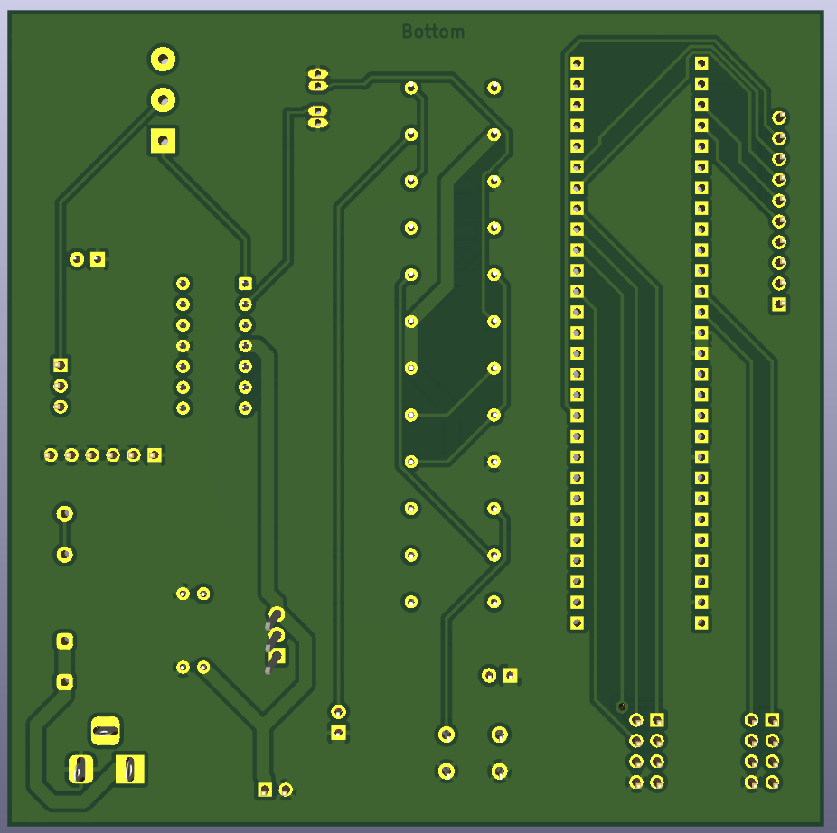

PCB Design
2-D View
Top:
{style width:"350" height:"300;"}

Bottom:
{style width:"350" height:"300;"}

3-D View
Top:
{style width:"350" height:"300;"}

Bottom:
{style width:"350" height:"300;"}

## Resouces

The PCB as a PDF download is available [*here*](png2pdf (2).pdf), the the Zip folder of the project is [*here*](Subsystem Schematic Design CL.zip), and the Gerber Files are available [*here*](GERBER.zip).